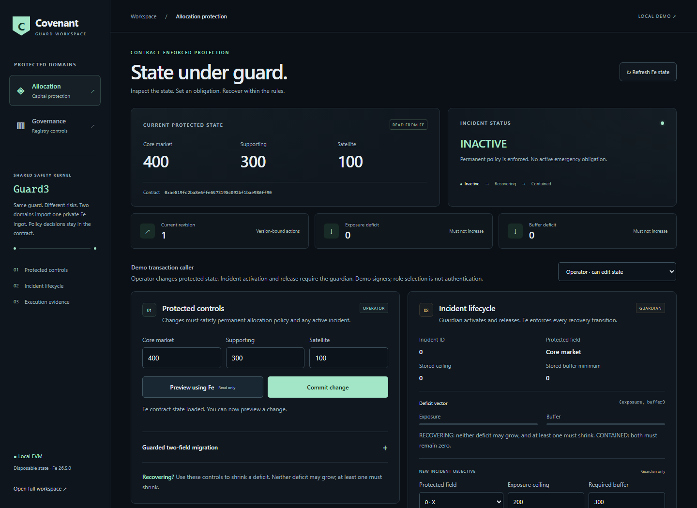
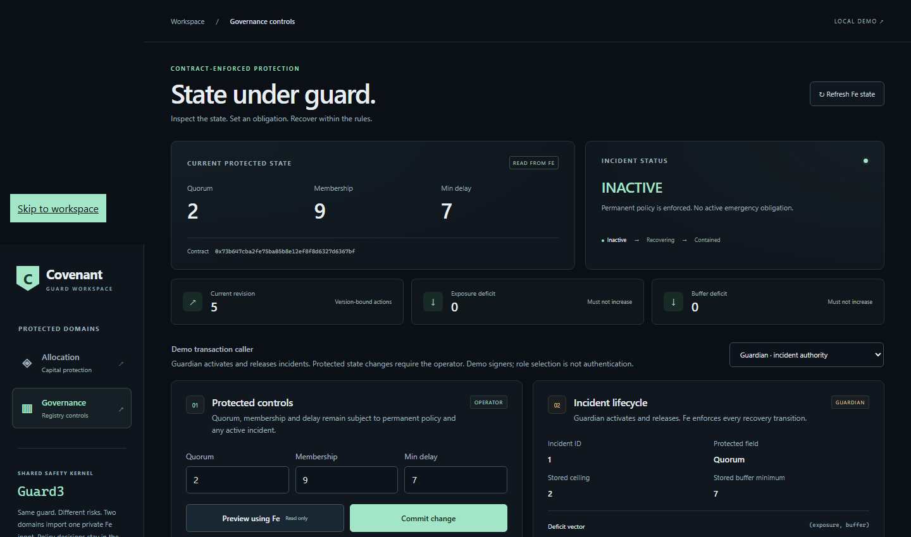
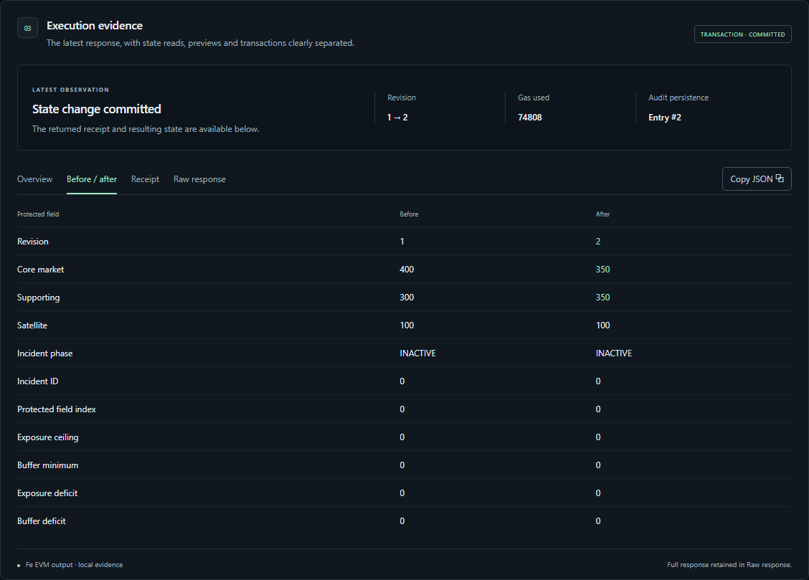
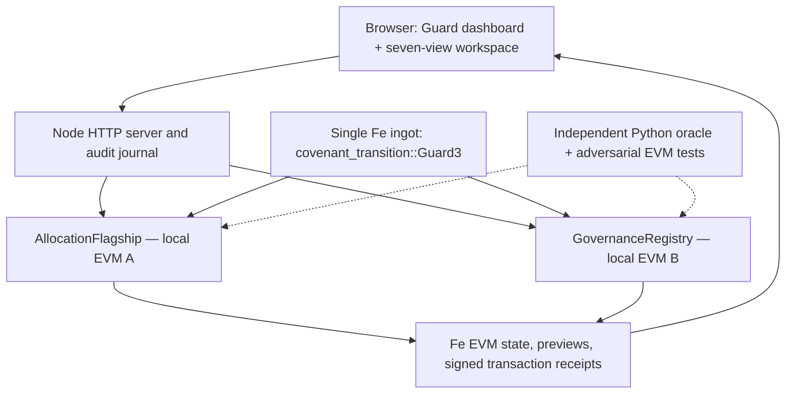

# Covenant Guard

**Safety rules that survive the emergency.**

A smart contract can reject an invalid transaction and still fail when it matters most: an emergency has been declared, but an otherwise valid update makes the situation worse. **Covenant Guard gives that emergency a persistent, contract-enforced obligation.** Until the obligation is satisfied, every protected transition must obey both the permanent rules and the recovery rules.

The core is **`covenant_transition::Guard3`**, a reusable [Fe 26.5.0](https://fe-lang.org/) ingot. A capital-allocation contract and a governance-registry contract import the **same private safety kernel**, configure different policies, and execute its checks in real compiled Fe bytecode on disposable local EVMs. A browser application makes the result visible; a Python oracle, signed EVM tests, compiled mutants and GitHub Actions make it reproducible.

> **For reviewers:** this is an experimental local-EVM demonstration, **not a live protocol**. The browser chooses disposable test signers; no wallet, funds, public chain, or production authentication is involved. The transaction receipts are real *local EVM* receipts, not public-chain transactions. Fe 26.x is [not production-ready](https://fe-lang.org/getting-started/installation/).



**Explore:** [Run locally](#run-it-locally) · [Try the incident in two minutes](#a-two-minute-incident-walkthrough) · [Why Fe](#why-fe-is-essential-here) · [Examine the evidence](#reproduce-the-evidence) · [Source map](#where-the-code-lives) · [Limitations](#scope-and-trust-boundaries)

**Release:** [`v0.1.0`](https://github.com/chizzydev/covenant-guard-fe/tree/v0.1.0) · **Frozen engineering commit:** [`1c05d8b`](https://github.com/chizzydev/covenant-guard-fe/commit/1c05d8b377777d462da8d7bdf7b7c5aac046346c) · **[Passing GitHub Actions evidence](https://github.com/chizzydev/covenant-guard-fe/actions/runs/42501254634)** · Fe Builders Challenge 2026, project **FE-034**.

## The important part in 30 seconds

Imagine a capital allocator with **1,000 units** of capacity. Initially, it holds 400 in Core, 300 in Supporting and 100 in Satellite; the remaining **200** is the emergency buffer.

A guardian detects an incident and installs two simultaneous requirements: **Core must be at most 200**, and **unused capacity must be at least 300**. The existing allocation now has two measurable deficits:

- **Exposure deficit:** `400 − 200 = 200`.
- **Buffer deficit:** `300 − 200 = 100`.

Covenant Guard permits a recovery step only if **neither deficit grows and at least one shrinks**. Reaching zero on both transitions the incident to **CONTAINED**. Only the guardian can release that exact incident, using the current revision and stored incident ID.

| Action on the real local Fe/EVM contract | Protected state (Core / Supporting / Satellite) | Deficits (exposure, buffer) | Outcome |
| --- | --- | --- | --- |
| Starting state | `400 / 300 / 100` | No active incident | Permanent policy enforced |
| Guardian activates progressive protection | `400 / 300 / 100` | **(200, 100)** | Incident stored; **RECOVERING** |
| Operator reallocates safely | `300 / 300 / 100` | **(100, 0)** | Accepted; both deficits do not worsen |
| Operator tries to increase Core again | Proposed `350 / 300 / 100` | Would become **(150, 50)** | **Rejected; state and revision unchanged** |
| Operator completes containment | `200 / 300 / 100` | **(0, 0)** | Accepted; **CONTAINED** |
| Guardian releases by incident ID | `200 / 300 / 100` | No active incident | Accepted; permanent policy remains |

**The rejected proposal can satisfy ordinary capacity limits.** It fails because the *stored emergency obligation* is still in force. The browser doesn't calculate permission or silently block the write: **the compiled Fe contract rejects it**. Failed transactions do not advance protected state; successful commits advance the revision.

That is the central idea: **incident handling is a state-transition invariant, not a dashboard warning or a policy somebody has to remember to reapply.**

## Why Fe is essential here

Covenant Guard is not a JavaScript validator with Fe attached. The actual enforcement lives in [`Guard3`](library/covenant_transition/src/lib.fe), imported by two separately compiled consumer ingots.

The reusable abstraction owns four **private** fields: the guarded triple, permanent rules, revision and active incident. Consumers may borrow a mutable **draft**, but they are not lent the private policy metadata. The Fe implementation's checked-edit boundary looks like this (abridged from the source):

```fe
pub fn checked_edit(mut self, _ expected: u256) -> mut TripleDraft {
    assert!(expected == self.revision)
    let before = self.value
    var candidate = before
    yield mut candidate
    assert!(triple_permanent_mask(candidate, self.rules) == 0)
    assert!(triple_transition_mask(before, candidate, self.rules, self.incident) == 0)
    // If both deficits are zero, promote RECOVERING to CONTAINED.
    self.value = candidate
    self.revision += 1
}
```

**Why the design matters:** the caller edits a projected draft; the Fe guard checks the completed candidate against its own private permanent policy and incident obligation before publishing the new state. A multi-field edit can cross an invalid intermediate configuration without committing that intermediate state. Explicit mutability and Fe's checked-access pattern make the protection boundary concrete and testable.

There are other important boundaries:

| Boundary | What actually enforces it |
| --- | --- |
| **Permanent rules** | Fe checks ranges, capacity/reserve, ratios and domain-specific bounds on final state. |
| **Recovery** | Fe compares the *before* and *after* two-component deficit vector for each protected change. |
| **Incident lifecycle** | The guardian installs the objective; the contract stores phase, ID and limits until contained and released. |
| **Replay / stale writes** | Fe enforces the expected revision; release additionally requires the precise incident ID. |
| **Operator vs guardian** | Consumer contract logic uses the actual EVM caller, not the browser's displayed role. |
| **Preview vs commit** | Preview is a real Fe static EVM call; commit is an actual signed transaction in the local VM. |

These properties are **not uniquely impossible in Solidity**, and a malicious consumer could replace its whole guard wrapper if it exposed that power. The contribution is a reusable, Fe-native checked-transition abstraction with a working multi-domain demonstration and adversarial evidence—not a claim of universal or formally proved security.

### One kernel, two different risk models

| | Capital allocation | Governance registry |
| --- | --- | --- |
| Reference contract | [`AllocationFlagship`](consumers/allocation_flagship/src/lib.fe) | [`GovernanceRegistry`](consumers/governance_registry/src/lib.fe) |
| Protected triple | Core, Supporting, Satellite | Quorum, Membership, Minimum execution delay |
| Permanent policy example | Capacity, reserve floor, per-market caps and Core/Supporting ratio | Quorum cannot exceed membership; quorum/delay lower bounds |
| Emergency exposure | Core exceeds a stored ceiling | Quorum exceeds a stored ceiling |
| Emergency buffer | **Unused allocation capacity** | **Minimum execution delay** |
| Example objective | Core ≤ 200; unused buffer ≥ 300 | Quorum ≤ 2; delay ≥ 7 |

The two contracts have different policy meanings and limits. They do **not** copy-paste separate guard implementations. In the default local server, the original seven-view allocation workspace and Guard dashboard share **one AllocationFlagship state**; governance is demonstrated in its **own disposable EVM instance**.



## Run it locally

**You need:** Git, [Fe **26.5.0**](https://fe-lang.org/getting-started/installation/), Node.js **20.12+**, npm and a browser. Node 24 was used in the qualified CI run. No MetaMask, faucet tokens, RPC credentials, Docker or external blockchain are needed for the interactive demo.

1. Install the official Fe 26.5.0 compiler. Verify that `fe --version` reports `fe 26.5.0 (3dab95f)`.
2. From a fresh terminal, run:

```bash
git clone https://github.com/chizzydev/covenant-guard-fe.git
cd covenant-guard-fe
git checkout v0.1.0

# Two independently compiled Fe consumers, both importing Guard3.
fe build --out-dir artifacts/guard/flagship consumers/allocation_flagship
fe build --out-dir artifacts/guard/governance consumers/governance_registry

npm ci
npm start
```

Leave the terminal open; successful startup reports `COVENANT_LOCAL_EVM=READY` and `GUARD_EVM=READY`.

| Open locally | URL | What you can inspect |
| --- | --- | --- |
| **Guard workspace** | http://127.0.0.1:4549/guard.html | Allocation and governance, operator/guardian actions, incidents and evidence |
| **Seven-view flagship** | http://127.0.0.1:4549/ | Planner, operations, migrations, incident desk, catalog, history and shared allocation state |
| **Current Guard state** | http://127.0.0.1:4549/api/guard/state | Read-only Fe EVM snapshots of both domains |

Stop the server with **Ctrl+C**. `PORT=4551 npm start` (Bash) or `$env:PORT='4551'; npm start` (PowerShell) selects another loopback port if 4549 is occupied.

**What resets?** Contract balances, revisions and incidents live in disposable in-memory EthereumJS VMs and reset on restart. The local hash-linked JSONL journal survives; it is not blockchain-authenticated or tamper-proof. The application supplies synthetic signers for demonstrations—**do not connect real wallets or deploy these demo keys**.

### A two-minute incident walkthrough

Start from a fresh application session. Open **Guard workspace → Allocation**:

| Step | Do this | What to watch |
| --- | --- | --- |
| **1. Inspect** | Start in Allocation with the Operator selected. Read the `400 / 300 / 100` protected state and revision 1. | No active incident. The evidence inspector correctly says **read-only state**, not “transaction submitted.” |
| **2. Declare the incident** | Choose **Guardian**, keep **Core** selected, enter exposure ceiling **200** and required buffer **300**, then choose **Activate progressive**. | A stored **RECOVERING** incident appears. Exposure and buffer deficits become **(200, 100)**. |
| **3. Recover safely** | Switch to **Operator**, set Core/Supporting/Satellite to **300 / 300 / 100**, preview and commit. | Fe accepts; the deficits improve to **(100, 0)**. The transaction's before/after values and receipt are available in **Execution evidence**. |
| **4. Try a shortcut** | Try **350 / 300 / 100**, then commit. | The Fe EVM rejects the worsening transition. The state and revision do not change. |
| **5. Finish containment** | Set **200 / 300 / 100** and commit. | Both deficits reach zero and the stored phase changes to **CONTAINED**. |
| **6. Release** | Select **Guardian** and choose **Release current incident by exact ID**. | The matching incident is released; permanent safety rules still apply. |

**Try the second consumer:** switch to **Governance**, where the initial state is quorum **5**, membership **9**, delay **2**. A guardian objective of quorum ceiling **0** is rejected because the permanent minimum quorum is **1**; a feasible objective of quorum ceiling **2** and delay minimum **7** can be recovered toward `(2, 9, 7)` and then released. That shows real reuse, not a renamed allocation screen.

### Evidence you can actually inspect

The redesigned interface separates **Overview**, **Before / after**, **Receipt** and **Raw response**, with copyable original JSON. Read-only state inspections and previews do not invent transaction hashes; signed commits report their actual local EVM receipts. Rejections retain before/after state, and audit-degraded outcomes are explicitly distinguished from EVM reverts.



## How the application is put together



The source is designed so that the **Fe contracts decide safety**. The Node adapter serializes calls against the local VMs, performs defensive before/after consistency checks and appends local audit records. The browser presents state and evidence; it does not authoritatively implement the guard predicates.

The default allocation state is owned by `AllocationFlagship`, not by two conflicting local allocation contracts. Historical P06/P07 compatibility fixtures remain for regression testing, not as alternative production implementations.

## Reproduce the evidence

The frozen engineering source at [`v0.1.0`](https://github.com/chizzydev/covenant-guard-fe/tree/v0.1.0) passed the complete P09 gate on Windows and Ubuntu. GitHub Actions independently completed its **full Fe/EVM/Python oracle/mutation suite** on the exact merged `main` commit [`1c05d8b`](https://github.com/chizzydev/covenant-guard-fe/commit/1c05d8b377777d462da8d7bdf7b7c5aac046346c).

**[Inspect the green final GitHub Actions run and downloadable evidence artifact](https://github.com/chizzydev/covenant-guard-fe/actions/runs/42501254634)**. The artifact is named `covenant-guard-p09-42501254634`. The UI's separate Chromium acceptance was performed locally; do not confuse it with the hosted GitHub gate.

| Verification | Observed result |
| --- | --- |
| Baseline Fe tests | **98 passed** across six source groups |
| Additional P09 Fe tests | **3 passed** |
| Baseline Node tests | **45 passed** |
| Additional P09 engineering regression tests | **27 passed** |
| Independent Python oracle tests | **15 passed** |
| Seeded signed-EVM differential actions | **300**, including **201 rejected transactions** |
| Authorization / selector / incident-phase cases | **72** |
| Fe preview comparisons | **432** |
| Deliberately faulty compiled Fe mutants | **11 of 11 detected** (8 baseline + 3 P09) |
| Six-step independent judge witness | **4 accepted, 2 rejected** |
| Headless Chromium acceptance | **PASS**, including real commits, rejection, recovery, audit failure and responsive layouts |
| Complete P09 runner | **PASS** on Windows, Ubuntu and final GitHub Actions |

To replay the **complete** gate, install Node/npm and Python 3.12 alongside the exact approved Fe 26.5.0 binary, then run from the repository root:

```bash
# Ubuntu 24.04 / Linux
P09_FE_EXE="$(command -v fe)" bash RUN_P09_UBUNTU.sh
```

```powershell
# Windows 11 / PowerShell 7
$env:P09_FE_EXE = (Get-Command fe).Source
pwsh -NoProfile -ExecutionPolicy Bypass -File .\RUN_P09_WINDOWS.ps1
```

The acceptance script **fails closed** if the Fe binary hash doesn't match the qualified platform binary; merely reporting the right version is insufficient. The approved v26.5.0 SHA-256 digests are:

| Platform | Expected Fe binary SHA-256 |
| --- | --- |
| Linux x86-64 | `3732fbe8a6e9d2ea3925d02d0e3a1478bc1e01d742c2be75d3ea7300c46c45f0` |
| Windows x86-64 | `d86ca3c6fdadeb8335f7033e3a68fdb7d2aab4eafd22c1e23bec047d2a8b2674` |

The full gate checks the root ingot, Fe consumers, expected compiler access rejections, real signed-EVM transactions, independent oracle agreement, deliberately faulty compiled variants, preserved legacy behavior, audit failures and source integrity. It generates fresh files under `results/p09/` and `results/p07/`. For a shorter direct EVM demonstration after the build, run `node p08/judge-witness.mjs`; it emits `results/p08/JUDGE_WITNESS.json`.

**What these results mean:** the specified, reproducible local properties passed the tested compiler and EVM. They are **not** formal verification, a third-party security audit, live-chain finality or a guarantee against unknown bugs.

### Failures we intentionally tested

Covenant Guard's tests do not just exercise the happy path:

- An **impossible guardian objective** must fail without storing an unusable recovery state (for example, quorum maximum zero when permanent minimum is one).
- A **stale revision**, wrong incident ID, unauthorized operator/guardian action or regressive recovery must not change protected state.
- A **post-commit journal write failure** must not misreport a completed transaction as a revert or tell a reviewer to retry it blindly. The UI reports **committed but audit-degraded**, blocks further writes and supports controlled reconciliation without replaying the EVM transaction.
- Compiled Fe mutants deliberately break incident identity or individual deficit dimensions; the adversarial suite must detect the wrong behavior.

## Where the code lives

| Location | What it contains |
| --- | --- |
| [`library/covenant_transition`](library/covenant_transition) | **One reusable Fe Guard3 implementation**, private incident state and checked transition logic |
| [`consumers/allocation_flagship`](consumers/allocation_flagship) | Single-state allocation consumer imported by the seven-view app and Guard page |
| [`consumers/governance_registry`](consumers/governance_registry) | Different policy domain using the same Fe ingot |
| [`fe.toml`](fe.toml), [`src/lib.fe`](src/lib.fe) | Root Fe ingot and reusable-library adoption example |
| [`app/server.mjs`](app/server.mjs), [`app/guard-api.mjs`](app/guard-api.mjs) | Loopback HTTP server and typed Fe EVM integration routes |
| [`app/public/guard.html`](app/public/guard.html), [`app/public/guard.js`](app/public/guard.js), [`app/public/guard.css`](app/public/guard.css) | Judge-facing Guard dashboard and evidence inspector |
| [`app/public/index.html`](app/public/index.html) | Original seven-view allocation workspace |
| [`p07/spec/oracle.py`](p07/spec/oracle.py) | Independent numerical policy oracle |
| [`p07/tests`](p07/tests), [`p09/tests`](p09/tests) | Differential testing, compiled mutants and engineering regressions |
| [`p08/judge-witness.mjs`](p08/judge-witness.mjs) | Six-action standalone local Fe EVM witness |
| [`p09/ui-acceptance.mjs`](p09/ui-acceptance.mjs) | Headless Chromium end-to-end regression harness (external Playwright/Chromium required) |
| [`RUN_P09_WINDOWS.ps1`](RUN_P09_WINDOWS.ps1), [`RUN_P09_UBUNTU.sh`](RUN_P09_UBUNTU.sh) | Full qualified acceptance entry points |
| [`.github/workflows/covenant-guard-verify.yml`](.github/workflows/covenant-guard-verify.yml) | Hosted security qualification and evidence artifact |

This repository retains earlier P01–P08 development stages and regression fixtures because historical compatibility is part of its evidence, **not** because judges must manually combine separate versions to run the application.

## Scope and trust boundaries

Covenant Guard is deliberately bounded:

- **Local demonstration only.** No deployed public-chain contract, real crypto transfers, production wallet or custodian role exists here. “On-chain” in the UI means *executed in local EVM bytecode*, not finalized on a public blockchain.
- **Demo authorization is not user identity.** The localhost server possesses disposable operator, reviewer and guardian keys. A viewer can switch roles; the Fe EVM enforces the selected signer's permissions, but the role selector itself is not authentication.
- **Trusted consumer boundary.** Guard3 keeps its own fields private; the embedding contract must not publish arbitrary replacement or bypass routes for the entire guard wrapper.
- **Specific safety model.** Guard3 protects a three-field numerical state with bounded constraints and two buffer definitions. It is not a universal smart-contract firewall, oracle, arbitrary-policy engine or production risk monitoring system. The guardian is a trusted authority for objective activation/release.
- **Audit evidence is local.** Journal entries are hash-linked and recovery-aware, but the host can edit the files. Restart resets the VM while the local journal persists.
- **Fe remains experimental.** Fe 26.5.0 is not production-ready; these tests provide bounded empirical assurance, not a formal correctness proof or security certification.

The implementation is open source under the repository's [MIT license](LICENSE). Dependencies such as EthereumJS, ethers and the Fe compiler retain their respective third-party licenses. Development included **AI-assisted engineering, testing, review and documentation**, directed and verified by the project owner. The repository history, exact release commit and generated qualification evidence are available for inspection.

---

**One reusable Fe guard. Two genuinely different risk domains. A stored obligation that a routine write cannot forget.**
